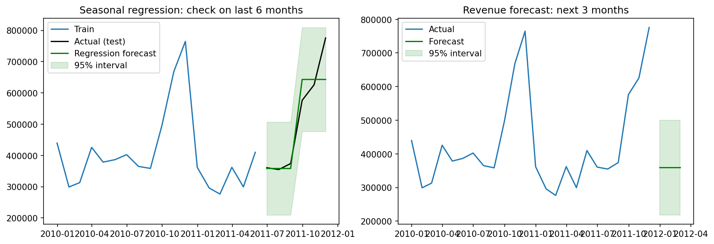

# Retail Analytics: Hypothesis Testing and Revenue Forecasting

A mini project that tests business questions with formal statistics and forecasts monthly revenue for an online retailer, using Python.

Built as part of my Data Analytics internship at Progree.

## Dataset

**Online Retail II** from the UCI Machine Learning Repository: about 1 million transactions from a UK online gift shop (Dec 2009 to Dec 2011).
The raw file is not included here because of its size. After cleaning (duplicates, returns, missing customer IDs, outliers), **723,576 transactions** were used.

## Questions and Methods

| Question | Method |
|---|---|
| Are Sunday invoices different from Mon-Fri invoices? | Welch t-test (on log invoice value) |
| Does invoice value differ between quarters? | One-way ANOVA + Tukey HSD post-hoc |
| Is customer segment linked to market (UK / non-UK)? | Chi-square test + Cramer's V |
| Can monthly revenue be forecast? | SARIMA and seasonal regression, compared with a seasonal-naive baseline |

## Key Results

**Hypothesis tests (alpha = 0.05)**

| Test | Result | Decision |
|---|---|---|
| t-test (Sunday vs Mon-Fri) | t = 1.094, p = 0.274 | No significant difference |
| ANOVA (quarters) | F = 6.583, p = 0.0002 | Quarters differ (Q2 is the weak quarter, about 6% lower) |
| Chi-square (segment vs market) | chi2 = 35.79, p < 0.001, V = 0.079 | Related, but weakly |

**Forecast models** (trained on 18 months, tested on the last 6)

| Model | RMSE | MAPE | Actual inside 95% interval |
|---|---|---|---|
| SARIMA(0,0,1) | 191,214 | 26.2% | 5 of 6 |
| Seasonal regression | 61,403 | 6.2% | 6 of 6 |
| Seasonal naive (baseline) | 41,705 | 6.8% | n/a |



## Business Insights

- Revenue rises by about **285,000 per month in Sep to Nov** compared with normal months.
- **Q2 is the weakest quarter**, so promotions in April to June could help.
- Sunday orders are similar in size to weekday orders, so no special Sunday strategy is needed.
- Non-UK customers are about 9% of all customers, but 14% of the New / Promising segment, so international customers tend to be newer.

## Limitations

- Only 24 months of data, so SARIMA could not learn the yearly seasonality (it needs at least 2 full cycles).
- The regression separates only peak and non-peak months, so it gives the same forecast for Dec, Jan and Feb.
- December 2011 is incomplete and was excluded.

## Project Structure

```
.
├── task4_analysis.ipynb      # full analysis
├── figures/                  # saved plots
└── README.md
```

## How to Run

```bash
pip install pandas numpy matplotlib seaborn scipy statsmodels
jupyter notebook task4_analysis.ipynb
```

Place the cleaned dataset in the path used by the notebook.

## Tools

Python, Pandas, NumPy, SciPy, Statsmodels, Matplotlib, Seaborn

## Author

**Nabiha Ilyas Siddiqui**
BS Computer Science, Sir Syed University of Engineering & Technology
Portfolio: nabiha-ilyas-portfolio.netlify.app | GitHub: Nabiha-Ilyas
